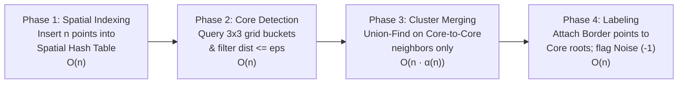

<div align="center">

# Spatial-Hashed DBSCAN (`linear-dbscan`)

**From-scratch Density-Based Spatial Clustering reducing time complexity from $O(n^2)$ to $O(n)$**


_%E2%86%92_O(n)-brightgreen?style=for-the-badge)
-orange?style=for-the-badge)


</div>

---

## Overview

Textbook implementations of **DBSCAN (Density-Based Spatial Clustering of Applications with Noise)** rely on brute-force nested loops over coordinate arrays and recursive BFS/DFS queues, resulting in $O(n^2)$ time complexity.

This project implements DBSCAN **entirely from scratch** without external ML or spatial libraries (`scikit-learn`, `scipy`, `numpy`). By combining a **Custom Spatial Hash Table** with a **Disjoint Set Union (Union-Find)** structure, the algorithm achieves **$O(n)$ expected runtime** in low-dimensional space while maintaining **100% exact label equivalence** with brute-force DBSCAN.

---

## Mathematical Foundation

### 1. Uniform Grid Quantization
To eliminate global pairwise distance scans, the 2D feature space is partitioned into a uniform square grid where each cell has side length $\epsilon$. Any point $P = (x, y)$ maps deterministically to integer grid coordinates in $O(1)$ time:

```math
g_x = \left\lfloor \frac{x}{\epsilon} \right\rfloor, \qquad g_y = \left\lfloor \frac{y}{\epsilon} \right\rfloor
```

### 2. Prime-Multiplier Spatial Hash Function
Non-empty grid cells are indexed into a hash table of size $M$ (chosen as a prime number maintaining load factor $\lambda \le 0.5$) using Teschner's spatial hashing formula and resolved via **Separate Chaining** (singly linked lists):

```math
h(g_x, g_y) = \left| (g_x \cdot 73856093) \oplus (g_y \cdot 19349663) \right| \bmod M
```

### 3. Exact $\epsilon$-Neighborhood Filtering
For any point $P$, candidate neighbors are retrieved strictly from its own cell $(g_x, g_y)$ and the **8 immediately adjacent cells** ($\Delta x, \Delta y \in \{-1, 0, +1\}$), followed by an exact Euclidean distance check to guarantee zero approximation error:

```math
N_{\epsilon}(P) = \left\{ Q \in \text{Cells}_{3 \times 3}(P) \;\middle|\; \sqrt{(x_P - x_Q)^2 + (y_P - y_Q)^2} \le \epsilon \right\}
```

<details>
<summary><b>Click to expand: Geometric Proof of the 3×3 Cell Guarantee</b></summary>
<br>

Suppose point $P$ lies anywhere inside grid cell $(g_x, g_y)$. Because every grid cell has width and height equal to $\epsilon$:
* Any cell at offset $\vert{}\Delta x\vert{} \ge 2$ or $\vert{}\Delta y\vert{} \ge 2$ is separated from $(g_x, g_y)$ by at least one full cell of width $\epsilon$.
* Therefore, any point $Q$ outside the $3 \times 3$ neighborhood strictly satisfies $\text{dist}(P, Q) > \epsilon$.
* Checking the 9 buckets in the $3 \times 3$ window is both **necessary and sufficient** to recover the exact $\epsilon$-neighborhood without scanning the remaining $n$ points.

</details>

---

## System Architecture (4-Phase Pipeline)

To prevent a single **Border Point** from falsely bridging two separate clusters, Union-Find merges are restricted strictly to **Core Points** ($\vert{}N_{\epsilon}(P)\vert{} \ge \text{min\_samples}$):



---

## Complexity Analysis

Let $n$ be the number of data points, $k$ be the average points per $\epsilon \times \epsilon$ cell, $d$ be the feature dimensionality, and $\alpha(n)$ be the Inverse Ackermann function ($\alpha(n) \le 4$ for all practical inputs).

| Algorithm / Case | Time Complexity | Space Complexity | Notes |
| :--- | :---: | :---: | :--- |
| **Brute-Force DBSCAN (Baseline)** | $O(n^2)$ | $O(n)$ | Computes all $\frac{n(n-1)}{2}$ pairwise distances. |
| **Spatial-Hashed DBSCAN (Expected)** | **$O(n)$** | **$O(n)$** | Bounded local density ($k = O(1)$) in low dimensions ($d = 2$). |
| **Spatial-Hashed DBSCAN (Worst Case)** | $O(n^2)$ | $O(n)$ | Occurs if $\epsilon$ spans the entire dataset ($k = n$ in one cell). |
| **High-Dimensional Scaling ($d$ dims)** | $O(3^d \cdot n)$ | $O(n)$ | Hypercube neighborhood grows exponentially with $d$. |

---

## Project Structure

```text
linear-dbscan/
├── src/
│   ├── data_structures/
│   │   ├── spatial_hash.py    # Custom hash table + singly linked list chaining
│   │   └── union_find.py      # Disjoint Set Union with path compression & rank
│   ├── algorithms/
│   │   ├── naive_dbscan.py    # O(n^2) brute-force baseline
│   │   └── fast_dbscan.py     # O(n) 4-phase Spatial-Hashed DBSCAN
│   └── utils/
│       └── dataset_gen.py     # Synthetic multi-cluster + noise generator
├── tests/
│   ├── test_structures.py     # Unit tests for hash collisions & DSU invariants
│   └── test_equivalence.py    # Proves 100% identical labels vs. naive DBSCAN
├── benchmarks/
│   └── run_benchmark.py       # Scaling tests from N = 500 to N = 50,000+
└── README.md
```

---

## Quick Start

```bash
# Clone the repository
git clone https://github.com/thsEmin/linear-dbscan.git
cd linear-dbscan

# Run correctness & equivalence verification
python -m unittest discover tests

# Run O(n^2) vs O(n) scaling benchmarks
python benchmarks/run_benchmark.py
```
